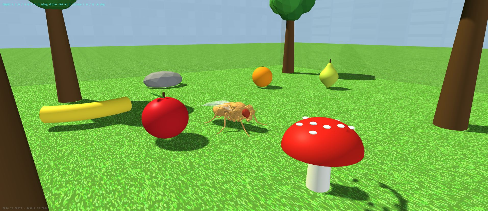
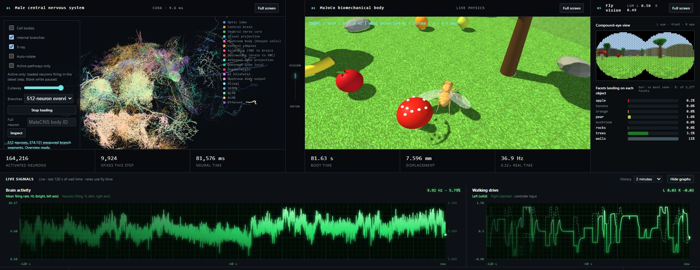

# Fly brain: MaleCNS connectome driving a physical fruit fly

A local, closed-loop simulation that wires the **complete male fruit fly central nervous system**
(MaleCNS v1.0: 166,700 neurons, 25.6 million connections) to a **physics-simulated fly body**
(FlyGym 2.1.0 on MuJoCo) and shows everything live in a browser.

The fly's two eyes cast rays into a 3D arena, those rays drive the real photoreceptor neurons,
the brain is simulated on the GPU, and descending neurons are decoded into walking and wing
movement. You can watch neurons fire, trace the activity over time, and poke the brain with
buttons to see what it does.





What you see in the dashboard:

1. **Male central nervous system**: neurons and measured branches, lighting up from real simulated spikes.
2. **MuJoCo body**: the fly in an arena with grass, trees, fruit and walls, driven by the brain.
3. **Fly vision**: a compound-eye view and how many eye facets land on each object.
4. **Live signals**: mean firing rate, percent of neurons firing and walking drive over time.

The wiring is measured. The neuron dynamics, eye optics and the brain-to-body interface are
**modelled assumptions**, not measured physiology (see [docs/TECHNICAL-NOTES.md](docs/TECHNICAL-NOTES.md)).

## Requirements

- **Windows 10 or 11** and PowerShell. The launch scripts are PowerShell; the Python code itself is portable.
- **NVIDIA GPU** with a recent driver is strongly recommended (the brain runs on CUDA through NVIDIA Warp). A slow CPU fallback exists.
- **Python 3.13** (the setup script installs it for you through [uv](https://docs.astral.sh/uv/getting-started/installation/)).
- [Git](https://git-scm.com/downloads) and [uv](https://docs.astral.sh/uv/getting-started/installation/).
- **About 3 GB of free disk space** for data, the Python environment and caches.

## Large downloads (not in this repository)

You download these yourself. Nothing below is stored in the repo.

| What | Source | Size |
|---|---|---|
| MaleCNS v1.0 connectome tables (annotations, neurotransmitters, edges) | `scripts\Download-MaleCNS.ps1` fetches them from the official release: [male-cns.janelia.org/download](https://male-cns.janelia.org/download/), bucket `https://storage.googleapis.com/flyem-male-cns/v1.0/connectome-data/flat-connectome` | about 1.1 GB |
| Prepared brain graph (`brain_graph.npz`) | built locally from the tables above by `flybrain_local.prepare` | about 270 MB output |
| FlyGym 2.1.0 body model and meshes | [github.com/NeLy-EPFL/flygym](https://github.com/NeLy-EPFL/flygym), tag `v2.1.0` (clone into `vendor\flygym`) | small (a source checkout) |
| Neuron skeletons for the internal branches | fetched on demand by the app, per neuron, from `https://storage.googleapis.com/flyem-male-cns/v1.0/segmentation/skeletons-malecns/skeletons-precomputed/` | grows with how many neurons you load |
| Optional: raw electron microscope slices | [EM-slices/](EM-slices/README.md) scripts, from the same MaleCNS release | about 0.5 GB |

## Setup

Run these in PowerShell.

**1. Clone this repo and FlyGym**

```powershell
git clone https://github.com/JacoMoolman/fly-brain.git
cd fly-brain
git clone --branch v2.1.0 --depth 1 https://github.com/NeLy-EPFL/flygym.git vendor\flygym
```

**2. Choose where things live**

Open `scripts\Set-FlyBrainEnv.ps1` and change the two variables at the top:

```powershell
$ProjectRoot = 'G:\FLYBRAIN'            # where you cloned this repo
$AssetRoot   = 'J:\models\fruit fly'    # where the data, Python environment and caches go
```

Then edit the same paths in `config\paths.json` (`projectRoot`, `assetRoot`, `datasetRoot`,
`environmentRoot`, `cacheRoot`, `recordingRoot`, `resultRoot`) so they match `$AssetRoot`.

> This project deliberately refuses to keep its data on `C:` (the storage guard in
> `src\flybrain_local\paths.py` and `scripts\Set-FlyBrainEnv.ps1`). If you only have a `C:` drive,
> remove those checks.

**3. Create the Python environment**

```powershell
.\scripts\Setup-Python.ps1
```

**4. Download the brain data**

```powershell
.\scripts\Download-MaleCNS.ps1 -SkipStats
```

`-SkipStats` skips an optional 778 MB table that this app does not use. Files are verified by size and SHA-256.

**5. Build the brain graph (one time; it scans the 1 GB edge table, so give it a while)**

```powershell
. .\scripts\Set-FlyBrainEnv.ps1
& "$env:FLYBRAIN_ASSET_ROOT\envs\flybrain\Scripts\python.exe" -m flybrain_local.prepare
```

**6. Run it**

```powershell
.\scripts\Start-FlyBrain.ps1
```

or double-click `START-FLY-BRAIN.cmd`. The page opens at <http://127.0.0.1:8765>. The first start
takes a little while to load the graph onto the GPU. Stop it with `Ctrl+C` in that window or
`STOP-FLY-BRAIN.cmd`.

## Using it

- **Forward / Turn / Escape walk / Backward**: brief neural stimulation of the matching descending neurons.
- **Flap wings**: stimulates the wing descending neurons; while the wings beat the body is lifted 3 mm and held level (a simple placement, not flight physics).
- **Random**: sends random movement commands; the box sets roughly how many per minute.
- **Controller assist**: optional extra walking drive. The default is zero, so by default the brain alone decides.
- **Fly + brain** (top bar): full screen with only the 3D fly and the brain activity graph.
- Each 3D view also has its own **Full screen** button. The brain view auto-rotates when idle (toggle in the panel).

## Verification scripts

Check that the pieces behave as documented, from the project Python environment:

```powershell
.\scripts\Verify-FlyGym.ps1
.\scripts\Verify-Integrated.ps1
```

`scripts\verify_*.py` hold the individual checks (GPU/CPU parity, walking, vision, wings, morphology).
Some of them still contain the author's example paths near the top and need editing first.

## Optional: raw EM images

The slices the connectome was reconstructed from are public. [EM-slices/](EM-slices/README.md)
has scripts that estimate the download size, fetch consecutive grayscale slices and turn them
into a looping video.

## Credits and licences

- **MaleCNS v1.0 data**: FlyEM (HHMI Janelia), the University of Cambridge (Department of Zoology), the MRC Laboratory of Molecular Biology, and Google Research. Licensed [CC BY 4.0](https://creativecommons.org/licenses/by/4.0/). Paper: [Sexual dimorphism in the complete Drosophila male central nervous system connectome, Cell (2026)](https://www.cell.com/cell/fulltext/S0092-8674(26)00942-6). Explore it in the [interactive viewer](https://neuroglancer-demo.appspot.com/#!gs://flyem-male-cns/v1.0/male-cns-v1.0.json).
- **FlyGym / NeuroMechFly**: [NeLy-EPFL/flygym](https://github.com/NeLy-EPFL/flygym) (Apache 2.0).
- **MuJoCo** and **NVIDIA Warp** for physics and GPU compute; **three.js** (MIT, bundled in `gui/vendor`) for the 3D views.
- The wing neuron link to wing amplitude (DNg02) follows [this paper](https://pmc.ncbi.nlm.nih.gov/articles/PMC9206711/).

No licence has been chosen for the code in this repository yet.
